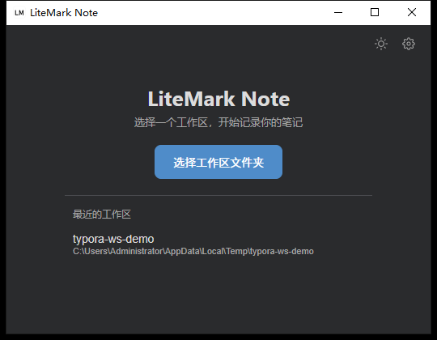
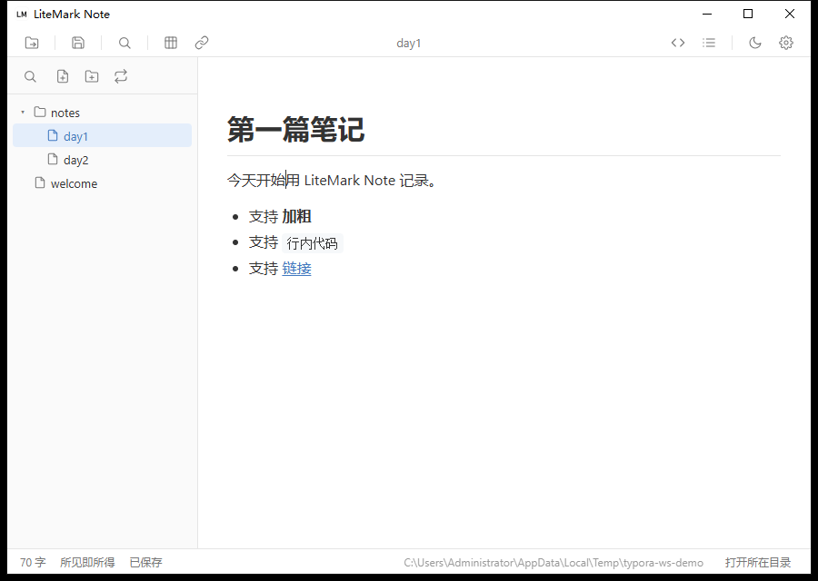
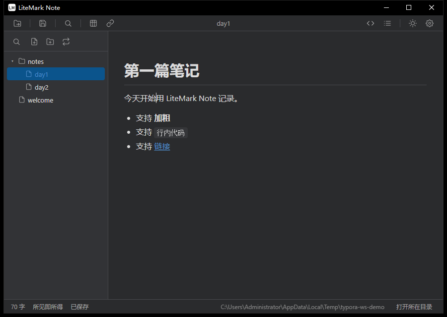
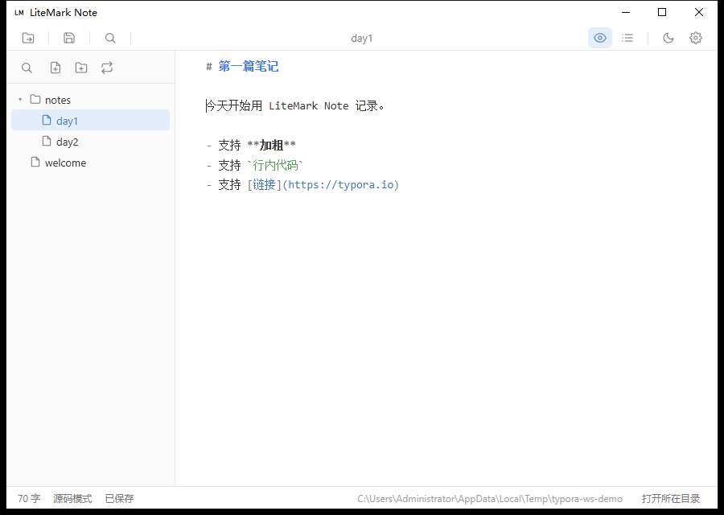
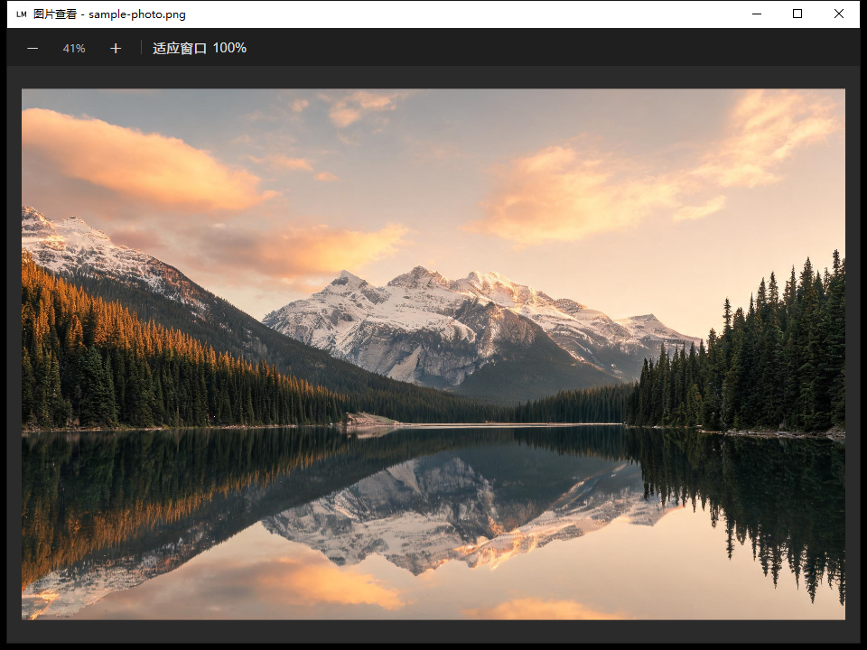

# LiteMark Note

一个用 **Go + Wails + Tiptap** 实现的 Markdown 笔记软件：以「工作区」文件夹为根目录，
左侧文件树管理笔记，右侧居中纸张排版，所见即所得编辑，随时切到源码模式查看/修改文件原文。



## 界面预览

工作区笔记浏览（左侧文件树，支持目录折叠、右键新建 / 重命名 / 删除）：


| 所见即所得（亮色） | 所见即所得（暗色） |
| --- | --- |
|  |  |

源码模式（CodeMirror 6，直接显示磁盘上的原始文本，带 Markdown / 代码语法高亮）：



图片查看器（滚轮缩放、拖拽平移、适应窗口 / 原始尺寸）：



## 功能

- **工作区**：启动时选择一个文件夹作为工作区，软件只在这个目录里管理笔记；左侧文件树列出所有 `.md` 笔记与子目录，目录可展开/折叠。
- **文件管理**：在文件树里直接新建笔记、新建文件夹、重命名、删除（右键菜单或标题栏 ＋ 按钮），删除前会二次确认；重命名会保留 `.md` 扩展名。
- **所见即所得编辑**：基于 Tiptap（ProseMirror），标题、加粗、列表、表格、代码块等都是真实渲染的排版。
- **原地展开 Markdown 原文**：光标贴进行内格式（加粗、斜体、删除线、行内代码、链接）时，自动展开成真实的 `**粗体**`、`` `代码` `` 等字符；光标离开后自动收回。支持嵌套（如 `**加粗里的 \`代码\`**`、`***粗斜体***`）。
- **源码模式**：使用 CodeMirror 6，直接读写文件原文，不做「渲染结果再序列化」的往返转换；在源码里改过内容，切回所见即所得时会用原文重新解析，保证两种视图始终一致。
- **双向切换保持阅读位置**：切换时按当前视口约 1/3 处正在看的内容做行 ↔ 块映射，光标和滚动都会跟过去，而不是跳到光标所在处。
- **查找 / 替换**：Ctrl+F / Ctrl+H，所见即所得和源码模式都可用；支持区分大小写、全词匹配、正则表达式。
- **代码块语法高亮**：lowlight（highlight.js 词库），支持 20+ 语言，右上角可切换语言、一键复制。
- **图片**：粘贴、拖拽图片自动落盘到资源目录，可右键放大查看（详见下一节）。
- **大纲目录**：右侧可折叠面板；源码模式下按纯文本里的 `#` 行定位。
- **明暗主题**：整套配色（含 Windows 原生标题栏）随之切换。
- **其它**：切换笔记前自动落盘、2 秒防抖自动保存、标题栏点击重命名、系统托盘常驻（双击托盘图标可唤出主窗口）、最近工作区列表。
- **状态栏**：字数、当前模式、保存状态、工作区目录，以及一键「打开所在目录」在资源管理器中打开工作区；顶部工具栏左侧有「切换工作区」按钮。

## 工作区

- 启动后先进入工作区选择页：点「选择工作区文件夹」挑一个目录，或从「最近的工作区」里直接打开。
- 左侧文件树只显示子目录和 `.md` / `.markdown` 文件，隐藏以 `.` 开头的项，目录排在文件前面。
- 文件树顶栏三个按钮：新建笔记、新建文件夹、切换工作区；顶部工具栏也有「切换工作区」入口。
- 右键任意条目可新建笔记 / 新建文件夹（目录）、重命名、删除、在资源管理器中显示。
- 点击笔记即可打开编辑，打开时会自动展开它所在的各级目录并高亮当前项。
- 切换工作区、关闭到后台再唤出时，都会回到工作区选择页。
- 为突出「笔记软件」定位，已移除拖拽 `.md` 文件打开、注册文件关联、按文件另存为、多窗口打开文件等入口；拖拽图片插入笔记的能力保留。

## 图片

### 插入

- 直接把图片文件拖进编辑器，或粘贴截图 / 图片文件：图片会复制到资源目录，并在 Markdown 中写入引用路径。
- 从网页复制图片粘贴时，会自动下载到本地资源目录，避免文档依赖外部链接。
- 资源位置可在「设置」中切换：**相对路径**（存到文档同级资源文件夹，Markdown 里写相对路径）或**自定义目录**（统一存放，写绝对路径）。
- 网络图片地址（``）同样可以直接显示。

### 放大查看

在编辑器里对图片点右键，可以：

- **查看图片**：用独立窗口打开图片查看器，适合查看大图、细节截图。
- **打开图片所在目录**：在资源管理器中定位图片文件。

图片查看器支持的交互：

| 操作 | 效果 |
| --- | --- |
| 鼠标滚轮 | 以光标所在位置为中心缩放（5% ~ 4000%） |
| 按住左键拖动 | 平移图片 |
| 工具栏 `－` / `＋` | 以窗口中心缩放 |
| 工具栏「适应窗口」 | 按窗口大小等比缩放并居中 |
| 工具栏「100%」 | 恢复原始像素尺寸 |
| 双击图片 | 在「适应窗口」与「原始尺寸」之间切换 |
| 调整窗口大小 | 自动重新适应窗口 |


## 支持的语法

完整的示例文档见 [docs/syntax-demo.md](docs/syntax-demo.md)，直接拖进编辑器即可查看渲染效果。

| 元素 | 语法 | 说明 |
| --- | --- | --- |
| 标题 | `#` ~ `######` | 支持 1~6 级标题 |
| 加粗 | `**文字**` | 光标进入时展开为源码 |
| 斜体 | `*文字*` | 可与加粗嵌套 |
| 粗斜体 | `***文字***` | |
| 删除线 | `~~文字~~` | |
| 行内代码 | `` `代码` `` | 可以嵌套在加粗里 |
| 代码块 | ``` ```lang ``` | 带语法高亮，可切换语言 |
| 链接 | `[名称](地址)` | 粘贴纯 URL 也会自动转成链接 |
| 图片 | `` | 支持本地路径与网络地址 |
| 无序列表 | `- 项` | 支持嵌套 |
| 有序列表 | `1. 项` | |
| 任务列表 | `- [ ]` / `- [x]` | 可点击勾选 |
| 表格 | `\| 列 \| 列 \|` | 支持拖动调整列宽、右键增删行列 |
| 引用 | `> 文字` | |
| 分隔线 | `---` | |

不支持 Markdown 扩展语法（如高亮 `==文字==`、脚注、公式）。

## 快捷键

| 快捷键 | 功能 |
| --- | --- |
| `Ctrl + S` | 保存当前笔记 |
| `Ctrl + F` | 查找 |
| `Ctrl + H` | 查找 / 替换 |
| `Ctrl + /` | 切换源码模式 / 所见即所得 |
| `Enter` / `Shift + Enter` | 查找面板中跳到下一个 / 上一个匹配 |

## 构建

依赖：Go 1.26+、Node.js 20+、[Wails v2 CLI](https://wails.io/)、WebView2 运行时（Windows 10/11 一般已自带）。

```bash
go install github.com/wailsapp/wails/v2/cmd/wails@v2.17.1

cd frontend && npm install && cd ..

wails build            # 产物：build/bin/LiteMarkNote.exe
wails dev              # 开发模式（前端热更新）
```

## 自动打包

仓库内置 GitHub Actions 工作流 [.github/workflows/build-windows.yml](.github/workflows/build-windows.yml)，只构建 Windows x64 版本：

- **推送到 `main`**：构建后自动发布 / 更新滚动 Release（固定标签 `latest`，每次覆盖上传最新的 `LiteMarkNote.exe`），下载地址固定为
  `https://github.com/<owner>/<repo>/releases/download/latest/LiteMarkNote.exe`
- **推送 `v*` 标签**：额外创建带版本号的正式 Release（自动生成更新说明），并附带 `LiteMarkNote.exe`。
- **PR / 手动触发**：只构建并上传 artifact `LiteMarkNote-windows-amd64`，不发布 Release。

发版只需：

```bash
git tag v0.22.0
git push origin v0.22.0
```

## 目录结构

```
lite-mark-note/
├─ app.go                # Wails 绑定：文件读写、图片存储、设置
├─ workspace.go          # 工作区：目录树、新建/重命名/删除笔记与文件夹
├─ main.go               # 窗口、托盘、单实例、图片查看器
├─ settings.go
├─ frontend/
│  ├─ index.html
│  ├─ viewer.html        # 独立图片查看器窗口
│  └─ src/
│     ├─ main.js         # 工作区文件树、笔记打开保存、源码模式、查找替换、大纲
│     ├─ editor.js       # Tiptap 扩展、行内源码展开/收回、代码块高亮
│     ├─ viewer.js       # 图片查看器：缩放、平移、适应窗口
│     └─ style.css       # 主题与排版
├─ docs/
│  ├─ syntax-demo.md     # 全量语法示例（用于截图与自查）
│  └─ images/            # README 截图与示例图片
└─ .github/workflows/build-windows.yml
```

## 已知限制

- 仅支持 Windows（依赖 Wails 的 Windows 窗口与托盘实现）。
- 源码模式不做实时双向同步：在源码里修改后切回所见即所得时才会重新解析，以保证内容始终是文件原文。
- 高亮（`==文字==`）、脚注、数学公式等 Typora 扩展语法未实现。
- 工作区一次只能打开一个；不支持拖拽 `.md` 文件直接打开（笔记统一从文件树进入）。
